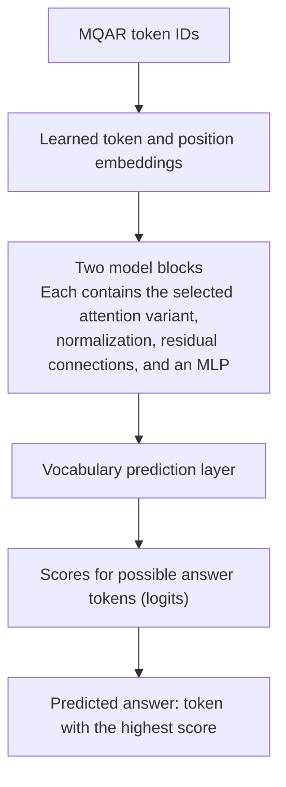

# Comparing linear attention variants hand written model experiment with Zoology
Building and evaluating linear attention variants with Zoology.


### Model pipeline



`model(input_tokens)` runs this full model, including our attention layer.
The attention layer transforms token representations. Zoology gives the
surrounding model, training loop, loss, optimizer, and evaluation.

To reuse the pipeline for another variant, change `model.sequence_mixer` in the
experiment config.

### Training step (simplified)

```python
import torch.nn.functional as F

logits = model(input_tokens)
loss = F.cross_entropy(
    logits.reshape(-1, logits.shape[-1]),
    target_answers.reshape(-1),
    ignore_index=-100,
)

optimizer.zero_grad()
loss.backward()
optimizer.step()
```

MQAR marks positions without a target answer as `-100`, so they do not contribute
to the loss.
